<!-- Profile README for github.com/ali-kassab. Local assets live in ./assets (SVG, no JavaScript). -->

  
  
  
  

📍 Giza, Egypt &nbsp;·&nbsp; Open to backend engineering roles

## About me

I'm a **Software Engineer** at **DevGlobal LLC** (remote, since 04/2024), where I build **Node.js / Express** backend services for a multi-tenant SaaS product. Outside work I build complete projects in **NestJS**, **Java / Spring Boot** and **ASP.NET Core** to go deeper on architecture, data modelling and testing.

- 🧱 **What I focus on:** REST API design, authentication and role-based access (JWT, RBAC), multi-tenant data isolation, relational data modelling, real-time features
- 🧪 **How I work:** layered or modular architecture, validation at every boundary, consistent error responses, automated unit and integration tests
- 🌱 **Currently deepening:** backend architecture and system design, Docker and CI/CD, cloud deployment
- 🤖 **Interested in:** AI-assisted engineering and modern developer tooling

## Featured projects

### 🛠️ [CRM Platform](https://github.com/ali-kassab/crm-platform) &nbsp;`in progress`
Multi-tenant field-service and operations SaaS: customers, work orders, visits, equipment and preventive maintenance, finance, subscriptions and a platform-admin console. A **Spring Boot 4** modular monolith with fail-closed tenant isolation, JWT/RBAC, an append-only audit log, Arabic/English PDF reports and a **NestJS + Socket.IO** real-time service over Redis. Backend tests use JUnit and Testcontainers; browser tests use Playwright.

### 📦 [TradeFlow](https://github.com/ali-kassab/tradeflow) &nbsp;`MVP`
Bilingual (Arabic RTL / English LTR) B2B wholesale management: products and stock ledger, customers and suppliers, sales and purchase orders, payments, ledger-style statements and reports. A **NestJS** modular monolith on **SQL Server** via Prisma, with tenant isolation enforced by composite foreign keys, rotating refresh tokens and Owner / Manager / Staff roles.

### 🔔 [Notification Service](https://github.com/ali-kassab/notification-service)
Self-hostable "notification as a service": a REST API and TypeScript SDK to send notifications that are stored in PostgreSQL and pushed over Socket.IO, with acknowledged delivery, per-user inboxes, hashed API keys, scoped user tokens and a React dashboard. Tested with Jest and Supertest against a real database.

### 🏦 [Banking Operations System](https://github.com/ali-kassab/banking-operations-system)
Bank back-office: customers, accounts, deposits, withdrawals, atomic transfers in an explicit transaction, optimistic concurrency on balances, and JWT with Admin / Employee roles. A layered **ASP.NET Core** Web API with an **Angular** client, unit-tested with xUnit.

### 🌐 [True Social](https://github.com/ali-kassab/True-Social)
Social network REST API: posts, comments, likes, follows, a personalised feed, saved posts, blocking and notifications. Stateless JWT with owner-or-admin authorization, DTO validation, RFC 7807 errors and no N+1 queries on paginated lists; unit and integration tests with JUnit 5, Mockito and MockMvc.

<b>Earlier work</b> (not public)

 

| Project | Description |
|---|---|
| **Java Spring Posts System** | RESTful API with Spring Boot, JWT authentication, layered architecture and role-based access control |
| **Java Spring Blog System** | Posts and comments with validation, global exception handling and a clean layered architecture |
| **Node.js Real-Time Notifications** | Socket.io and SSE for real-time notifications and messaging |
| **Stripe Payment Integration** | Node.js backend integrating Stripe for secure payment processing |
| **Twilio SMS/Call Automation** | Node.js service using the Twilio API for automated SMS and call workflows |

## Tech stack

| | |
|:--|:--|
| **Backend** |  |
| **Data** |  &nbsp;+ SQL Server |
| **DevOps & tooling** |  |
| **Frontend** |  |
| **Testing** | JUnit 5 · Mockito · Testcontainers · Jest · xUnit · Playwright |
| **Practices** | REST · JWT & RBAC · multi-tenancy · modular monolith · SOLID · design patterns |

## GitHub activity

Stats count public activity only. If a card does not load, see my <a href="https://github.com/ali-kassab?tab=repositories">repositories</a> directly.

**Let's talk backend.** I'm happy to discuss roles, APIs or architecture — reach me on [LinkedIn](https://www.linkedin.com/in/ali-kassab-8428161b8) or by [email](mailto:alikassab155@gmail.com).

