<!--
  GitHub profile README — github.com/ali-kassab
  Local graphics live in ./assets (pure SVG + CSS, no JavaScript; animations respect prefers-reduced-motion).
  External cards: skillicons.dev, shields.io, github-readme-stats, streak-stats, activity-graph, komarev.
-->

<div align="center">



<br />


<p>
  <a href="https://portfolio-alikassab.vercel.app/"></a>
  <a href="https://www.linkedin.com/in/ali-kassab-8428161b8"></a>
  <a href="mailto:alikassab155@gmail.com"></a>
  <a href="https://wa.me/201010044102"></a>
</p>

</div>


## About me

I'm a backend engineer at **DevGlobal LLC** (remote, since 04/2024), where I build **Node.js / Express** services for a multi-tenant SaaS product: REST APIs, JWT and role-based access, Stripe billing and real-time notifications with Socket.IO and SSE.
Outside work I build complete projects in **NestJS**, **Java / Spring Boot** and **ASP.NET Core** to go deeper on architecture, data modelling and testing.

```ts
const ali = {
  role:      "Backend Software Engineer",
  location:  "Giza, Egypt · open to remote",
  daily:     ["Node.js", "TypeScript", "Express", "NestJS"],      // professional, 2.5+ years
  alsoShip:  ["Java", "Spring Boot", "C#", "ASP.NET Core"],       // freelance & project work
  focus:     ["REST API design", "multi-tenancy", "JWT / RBAC", "data modelling", "real-time"],
  practices: ["layered & modular architecture", "validation at every boundary", "automated tests"],
  exploring: ["system design", "Docker & CI/CD", "cloud deployment", "AI-assisted engineering"],
};
```


## Featured projects

<a href="https://github.com/ali-kassab/crm-platform"></a>

A **Spring Boot 4 modular monolith** that rebuilds a legacy JavaScript CRM: customers, work orders, visits, maintenance, finance, subscriptions and a platform-admin console. Fail-closed tenant isolation, JWT / RBAC, an append-only audit log, Arabic / English PDF reports and a **NestJS + Socket.IO** real-time service over Redis. Tested with JUnit, Testcontainers and Playwright.

<a href="https://github.com/ali-kassab/tradeflow"></a>

Wholesale trade from stock to statement, in **Arabic (RTL)** or **English (LTR)**: products and a stock ledger, customers and suppliers, sales and purchase orders, payments, statements and reports. A **NestJS** modular monolith on **SQL Server** via Prisma, with tenant isolation enforced by composite foreign keys, rotating hashed refresh tokens with replay detection, Owner / Manager / Staff roles and GitHub Actions CI.

<a href="https://github.com/ali-kassab/notification-service"></a>

A REST API and **TypeScript SDK** that store notifications in PostgreSQL and push them over **Socket.IO**, with acknowledged delivery, per-user inboxes that survive going offline, SHA-256-hashed API keys, scoped short-lived user tokens and a React dashboard. Tested with Jest and Supertest against a real database.

<a href="https://github.com/ali-kassab/banking-operations-system"></a>

A bank back-office: customers, accounts, deposits, withdrawals, **atomic transfers** in an explicit transaction and per-account history. A layered **ASP.NET Core** Web API with EF Core, SQL Server and JWT (Admin / Employee roles), an **Angular** client and financial rules covered by xUnit tests.

<a href="https://github.com/ali-kassab/True-Social"></a>

A social network REST API: posts, comments, likes, follows, a personalised feed, saved posts, blocking and notifications. Stateless JWT with owner-or-admin authorization, DTO validation, RFC 7807 errors and no N+1 queries on paginated lists; unit and integration tests with JUnit 5, Mockito and MockMvc.

<details>
<summary><b>Earlier work</b> (private repositories)</summary>
<br />

| Project | Description |
|---|---|
| **Java Spring Posts System** | RESTful API with Spring Boot, JWT authentication, layered architecture and role-based access control |
| **Java Spring Blog System** | Posts and comments with validation, global exception handling and a clean layered architecture |
| **Node.js Real-Time Notifications** | Socket.IO and SSE for real-time notifications and messaging |
| **Stripe Payment Integration** | Node.js backend integrating Stripe for secure payment processing |
| **Twilio SMS/Call Automation** | Node.js service using the Twilio API for automated SMS and call workflows |

</details>


## Tech stack

| | |
|:--|:--|
| **Languages** |  |
| **Backend** |  |
| **Data** |   |
| **DevOps & tooling** |  |
| **Frontend** <sub>(supporting)</sub> |  |

**Depth, honestly:** Node.js / Express / NestJS professionally · Java / Spring Boot in freelance and project work · C# / ASP.NET Core in project work.

**Also worked with:** `Spring Security` `Spring Data JPA` `Hibernate` `EF Core` `OpenAPI / Swagger` `Socket.IO` `SSE` `Stripe` `Twilio` `JUnit 5` `Mockito` `Testcontainers` `Jest` `xUnit` `Playwright`
**Ops exposure:** `Kubernetes` `Terraform` `Prometheus` `Grafana` `Loki` · incident handling and root-cause analysis in application support


## GitHub activity

<div align="center">

<a href="https://github.com/ali-kassab?tab=repositories"></a>
<a href="https://github.com/ali-kassab?tab=repositories"></a>


<sub>Cards are served by third-party services and count public activity. If one doesn't load, browse my <a href="https://github.com/ali-kassab?tab=repositories">repositories</a> directly.</sub>

</div>


<div align="center">

**Let's talk backend.** I'm happy to discuss roles, APIs or architecture — reach me on [LinkedIn](https://www.linkedin.com/in/ali-kassab-8428161b8), by [email](mailto:alikassab155@gmail.com) or through my [portfolio](https://portfolio-alikassab.vercel.app/).


</div>
